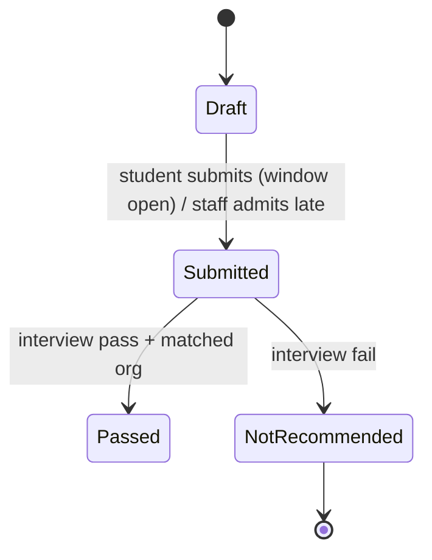
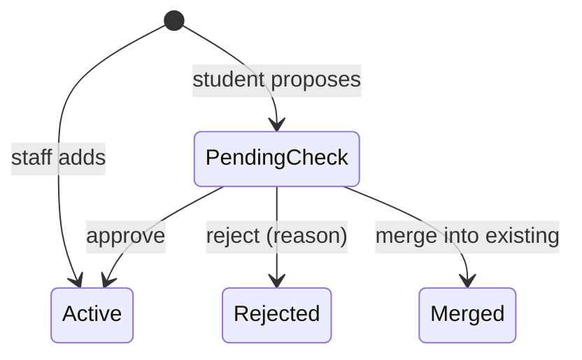
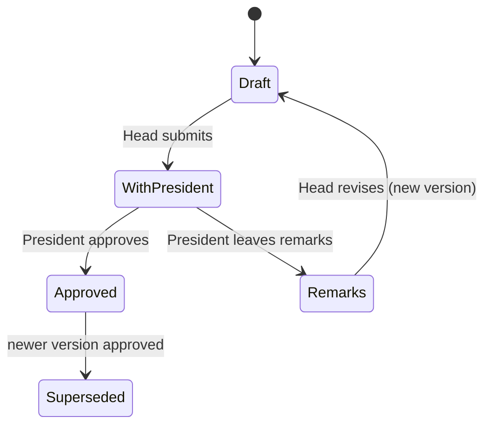
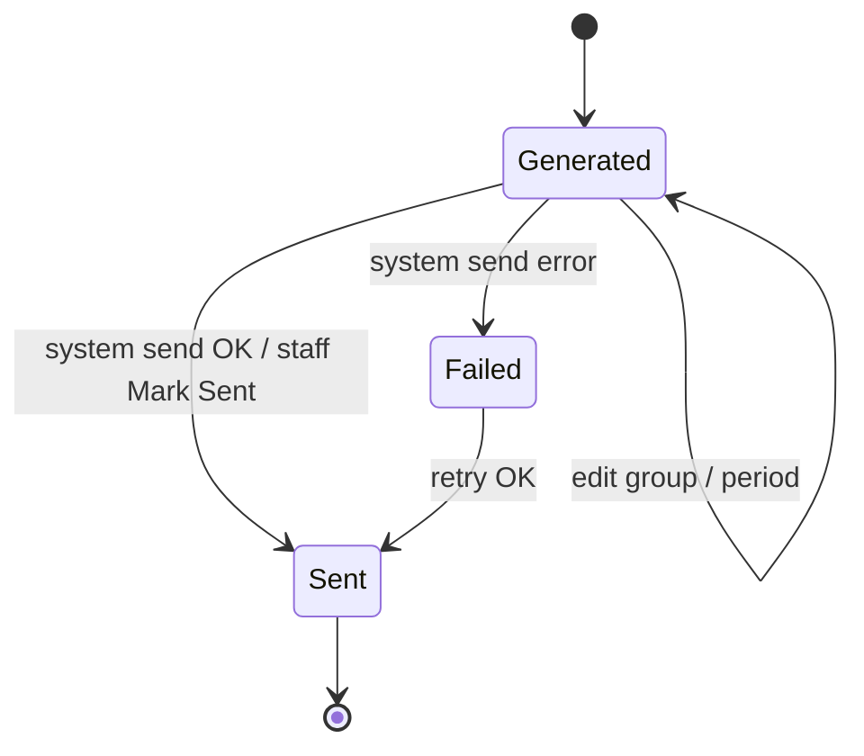
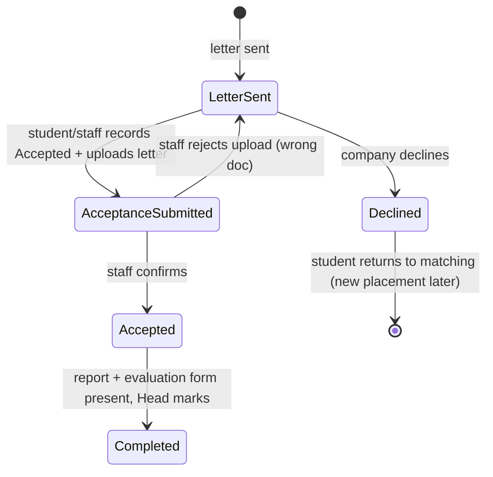

# 05 · Business Rules

Each rule has a matching automated test (AD17). The rule IDs are the same as in the discovery log.

## Rules

**BR1 · Applying.** A student may have **one application per cycle**. It can be submitted only while the cycle's window
is open. CS Staff may let a late application in by hand, and the system records who did. An application has 1 to 3
**ranked** choices, which can mix Active organisations and the student's own proposals. *(D9, D13, D24)*

**BR2 · Interview.** Staff record the outcome. **Pass** requires a matched organisation. **Not recommended** closes the
application for that cycle: no letters on either route, and the student may apply next cycle. *(D15, D22)*

**BR3 · Organisations students propose.** The student must search first. A proposal is created as **Pending check**.
Staff then do one of three things:
- **Approve:** it becomes Active and joins the shared list.
- **Merge:** it's folded into an existing organisation, and all references move across.
- **Reject:** the reason is shown to the student.

Nobody can be matched to an organisation that is Pending check or Rejected. A rejected proposal works like a company
decline: the student falls back to their other choices or proposes a new organisation. *(D12, D23)*

**BR4 · Template approval.** Each template version must be **approved by the President** before letters can use it.
Remarks send it back to the Head, and the last approved version stays in use meanwhile. If no version has ever been
approved, letters can't be generated. *(D4, D6)*

**BR5 · Letters.**
- One draft letter per organisation, grouping every passed-and-matched student without a letter. Staff may remove
  students before sending.
- Every field is filled automatically. The student ID never appears.
- Only the listed students' CVs are attached, with a total of about 20 MB at most.
- Sent by the system, or downloaded and then **marked Sent** (until then it shows "Generated, not sent").
- **Once sent, a letter can't be changed.** Students matched later get a new letter.
- No letters after the cycle's cut-off date. *(D14, D16–D20)*

**BR6 · Company declines.** The placement becomes **Declined**. The student goes back to matching: staff re-match from
other choices, or the student proposes a new organisation. There's no limit before the cut-off. *(D20, F11)*

**BR7 · Acceptance.** The company's answer is recorded by the student, or by staff when the company replied to Career
Services. "Accepted" needs the acceptance letter uploaded, and **staff confirmation** before the placement is Accepted. *(D1, F10)*

**BR8 · Completion.** It needs the **student's report** and the **company's evaluation form** (uploaded by staff, because
the company emails it to Career Services). Only the **Head** can mark Completed. A student's graduation requirement is
met once any of their placements is Completed. *(D13, D21, F15–F18)*

## Status lifecycles

### Application

### Organisation

### Template version

### Letter

### Placement (one per student per matched organisation)

## A student's overall stage (shown in lists and on the student's Home page)
Not started (registry only) → Applied → Not recommended | Matched → Letter sent → Accepted → **Completed**.
A student with a Declined placement and no new match shows **Needs re-match**.

## Rules still open
- OQ4 reference number format (proposed `CS/INT/{YEAR}/{SEQ}`).
- Staff rejecting an uploaded acceptance letter as the wrong document is a proposed safety step. It isn't confirmed in
  discovery, so confirm it at review.
