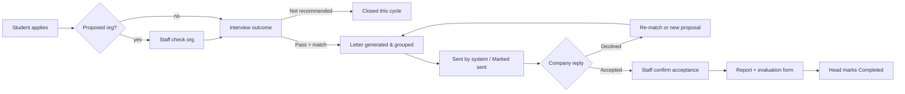

# 06 · User Workflows

## W0 · Cycle setup (Head) — once a year
1. The Head creates the cycle: name, application window, letter cut-off date, default internship dates (FR-C1).
2. The Head imports the registry CSV (preview, fix errors, commit) (FR-S2).
3. The Head checks that an **Approved** template exists. If not, see W5.
4. Career Services announces the cycle through the university mailing list, **outside the system** (D25).

## W1 · Student applies (Route A and/or Route B)
1. Register with university email → accept the privacy notice → confirm email (FR-A1, FR-A2).
2. Open **Apply** (only while the window is open):
   1. Check profile details (name, student ID, programme, level, phone).
   2. Choose up to 3 ranked organisations. Search the list first; if one isn't listed, **Propose an organisation**
      (it becomes Pending check).
   3. Write the motivation statement.
   4. Upload the CV (PDF).
   5. Review → Submit.
3. The Home page shows "Applied".

## W2 · Organisation check (Staff)
1. To do → **Organisations to check**.
2. Open a proposal and look up or call the organisation (F6). The system flags likely duplicates.
3. **Approve** (it joins the list) / **Merge** into an existing organisation / **Reject** with a reason.
4. The student gets an email with the result (FR-N1). A rejection leaves their other choices in place.

## W3 · Interview and match (Staff)
1. The interview is booked outside the system (D15).
2. To do → **Applications to interview** → open the application (ranked choices, motivation, CV).
3. Record the date, the outcome and notes.
   - **Pass** → choose the matched organisation (an Active one only).
   - **Not recommended** → the application closes for this cycle.
4. The student gets an email with the outcome.

## W4 · Produce and send letters (Staff) — the core flow
1. To do → **Letters ready** → **Letter workspace**.
2. The left side lists one draft per organisation, grouping its matched students who don't yet have a letter.
3. Select a group to see the live PDF preview on the right: reference number, addressee, students (name, programme,
   level), period, signature, attachment list and size.
4. Optionally **Edit group** (remove a student) or change the period for this letter.
5. Either:
   - **Send selected** → the system emails each letter in turn, with a progress bar. Each one shows Sent or Failed, and
     Failed letters can be retried.
   - **Download** → print or send it yourself → **Mark Sent**.
6. Each listed student's placement becomes **Letter sent**, and they get an email with a link to their copy.
7. Students matched later get a new letter. Sent letters are never edited.

## W5 · Template approval (Head → President)
1. Settings → Template → edit the draft (wording and placeholders) → **Send to President**.
2. The President gets an emailed invite or link, logs in (password + code), and sees the template filled with sample data.
3. **Approve** → this version is used for all new letters.
   **Reject with remarks** → the Head sees the remarks, revises the template and sends it again. Letters keep using the last
   approved version meanwhile.

## W6 · Company replies
- **Reply goes to the student:** the student opens the application → **Record company reply**:
  - Accepted → upload the acceptance letter → staff confirm it (To do → Acceptances to confirm).
  - Declined → the student is back in matching.
- **Reply goes to Career Services:** staff record it on the student's placement in the same way.
- **After a decline:** staff re-match from the student's other choices (W3 step 3, matched organisation only), or the
  student proposes a new organisation (W2). Then a new letter (W4). This can repeat any number of times until the cut-off.

## W7 · Completion
1. After the internship, the student uploads their **report**.
2. Career Services sends the blank evaluation form **outside the system**. When the company emails it back, staff upload it.
3. To do → **Ready to complete** (Head) → check both documents → **Mark Completed**.
4. The graduation report shows the student as Completed.

## W8 · Reports
Reports → choose a cycle or filters → view on screen → **Export CSV**. Release 1: pipeline and graduation status.
Release 2: by organisation, and by programme and sector.

## Flow overview

