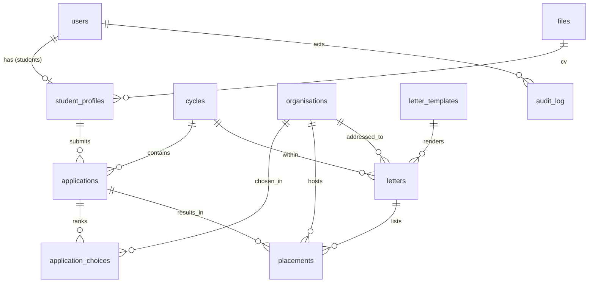

# 09 · Database Design (PostgreSQL on Neon)

Conventions: `id bigint` identity primary keys; `created_at`/`updated_at` timestamptz on every table; statuses are
`text` + `CHECK` constraints, so new values don't need enum migrations; files are referenced by `file_id` and stored in
object storage (AD6).

## Entity relationships

## Tables

### users
| Column | Type | Notes |
|---|---|---|
| email | citext UNIQUE NOT NULL | university domain for students |
| password_hash | text | |
| role | text CHECK (`student`,`staff`,`head`,`president`) | D5 |
| email_verified_at | timestamptz | D7 |
| is_active | bool default true | FR-A8 |
| privacy_accepted_at | timestamptz | NFR-P1 |
| last_login_at | timestamptz | |

### invitations
`email`, `role` (staff/head/president), `token_hash`, `expires_at`, `accepted_at`, `invited_by → users`. *(FR-A4)*

### otp_codes
`user_id → users`, `code_hash`, `expires_at`, `consumed_at`, `attempts int`. *(AD15)*

### student_profiles
| Column | Type | Notes |
|---|---|---|
| user_id | → users, UNIQUE, **nullable** | null = registry-only (D30) |
| university_email | citext UNIQUE NOT NULL | the key that links registry rows to accounts (D31) |
| full_name, programme | text NOT NULL | |
| student_number | text UNIQUE | **never printed on letters** (D14) |
| level | smallint | |
| phone | text | |
| expected_grad_year | smallint | A1 |
| on_registry | bool default false | D31 flag |
| cv_file_id | → files | |
| documents_purged_at | timestamptz | retention (R2) |

### cycles
`name` UNIQUE, `applications_open_at`, `applications_close_at`, `letter_cutoff_at`, `default_period_start date`,
`default_period_end date`. CHECK: open < close ≤ cutoff. *(FR-C1)*

### organisations
| Column | Type | Notes |
|---|---|---|
| name | text NOT NULL | trigram index for duplicate warnings (FR-O5) |
| address, email, contact_person, contact_title, phone, sector | text | D11. `email` is required to become Active (letters are emailed). |
| status | text CHECK (`pending_check`,`active`,`rejected`,`merged`) | BR3 |
| rejection_reason | text | shown to the student |
| merged_into_id | → organisations | |
| proposed_by_student_id | → student_profiles, nullable | |
| checked_by → users, checked_at | | audit |

### applications
| Column | Type | Notes |
|---|---|---|
| student_profile_id → student_profiles, cycle_id → cycles | | **UNIQUE (student_profile_id, cycle_id)** (BR1) |
| status | text CHECK (`draft`,`submitted`,`passed`,`not_recommended`) | |
| motivation | text | |
| submitted_at | timestamptz | |
| late_admitted_by | → users, nullable | D24 |
| interview_date | date | D15 |
| interview_notes | text | |
| matched_organisation_id | → organisations | required when status = passed |
| outcome_recorded_by | → users | |

### application_choices
`application_id`, `rank smallint CHECK (1..3)`, `organisation_id`. UNIQUE (application_id, rank), UNIQUE (application_id, organisation_id). *(D9)*

### letter_templates
`version int UNIQUE`, `body text` (with placeholders), `status` CHECK (`draft`,`with_president`,`approved`,`remarks`,`superseded`),
`submitted_by`, `submitted_at`, `decided_by`, `decided_at`, `remarks text`. Partial unique index: only one row may be `approved`. *(BR4)*

### letters
| Column | Type | Notes |
|---|---|---|
| reference_no | text UNIQUE | OQ4 |
| cycle_id, organisation_id, template_id | FKs | |
| issue_date, period_start, period_end | date | D16 |
| status | text CHECK (`generated`,`sent`,`failed`) | |
| send_mode | text CHECK (`system`,`manual`) null until sent | D18 |
| recipient_email | text | snapshot at send time |
| addressee_snapshot | jsonb | the organisation details exactly as printed |
| pdf_file_id | → files | stored once sent |
| sent_by → users, sent_at, failure_reason | | D34 send log |

A database trigger blocks any UPDATE to a letter whose `status = 'sent'`, except to audit columns. *(BR5: can't be changed)*

### placements
| Column | Type | Notes |
|---|---|---|
| application_id, student_profile_id, organisation_id, cycle_id | FKs | |
| letter_id | → letters, nullable | null = matched, letter pending |
| status | text CHECK (`letter_pending`,`letter_sent`,`acceptance_submitted`,`accepted`,`declined`,`completed`) | lifecycle in doc 05 |
| reply_recorded_by → users, reply_recorded_at | | BR7, F10 |
| acceptance_file_id, report_file_id, evaluation_file_id | → files | |
| acceptance_confirmed_by → users | | BR7 |
| completed_by → users, completed_at | | BR8, Head only |

Partial unique index: at most one *open* placement (status not in `declined`,`completed`) per application.
"Completed" for graduation = `EXISTS placement WHERE status='completed'` per student (D13).

### files
`kind` CHECK (`cv`,`letter_pdf`,`acceptance`,`report`,`evaluation`,`signature`,`registry_csv`), `storage_key` UNIQUE, `original_name`,
`mime`, `size_bytes`, `sha256`, `uploaded_by → users`, `deleted_at`. *(AD6, FR-X3)*

### Supporting tables
- **audit_log**: `actor_user_id`, `action`, `subject_type`, `subject_id`, `metadata jsonb`, `ip`, `created_at`. The
  app's database role can only INSERT and SELECT on it (AD16).
- **email_log**: `to_email`, `user_id`, `type` (interview_outcome, org_check, letter_sent, reminder_*, otp, invite), `status`,
  `error`, `sent_at`. Used to remove duplicate reminders and to count against the 500-a-day limit (NFR-R4).
- **registry_imports**: `file_id`, `imported_by`, `rows_total`, `rows_created`, `rows_updated`, `rows_failed`, `errors jsonb`.
- **settings**: `key` PRIMARY KEY, `value jsonb`. Covers reminder intervals, sending address, reference prefix, retention
  years, university email domain, and the signature `file_id`.

## Key indexes
`applications(cycle_id, status)` · `placements(status)` · `placements(student_profile_id)` · `organisations(status)` ·
`organisations USING gin (name gin_trgm_ops)` · `letters(cycle_id, status)` · `audit_log(subject_type, subject_id)`.
