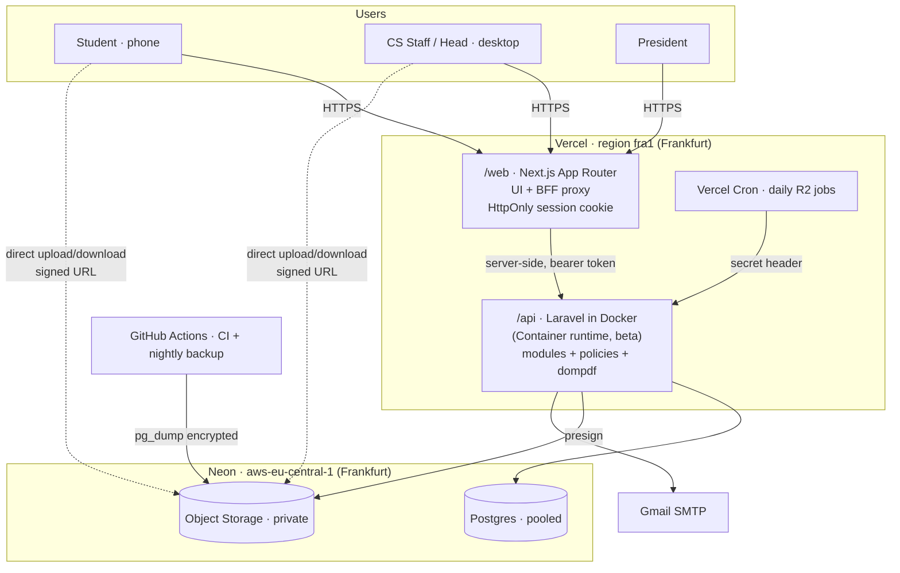

# 10 · System Architecture

## Overview

## Components
| Component | Technology | Responsibility | Decision |
|---|---|---|---|
| Web | Next.js (App Router, TypeScript), Tailwind, shadcn/ui | All screens. A backend-for-frontend proxy holds the session cookie and forwards to the API. | AD1, AD8, AD11 |
| API | Laravel (PHP) in a Docker image (FrankenPHP, as in Vercel's PHP-with-Docker guide) | Business rules, policies, PDFs, email, presigned links | AD1, AD5′ |
| Database | Neon Postgres, **pooled** connection string | System of record | AD9 |
| Files | Neon Object Storage (S3-compatible, Laravel `s3` driver, path-style) | CVs, letters, acceptance letters, reports, evaluation forms, signature, registry CSVs | AD6 |
| Email | Gmail SMTP with an app password | Letters, student notifications, login codes, invites | AD4, AD12 |
| PDF | dompdf (pure PHP) | Letters, with the signature added on the server | defaults |
| Scheduler | Vercel Cron, daily → `POST /internal/cron/*` with a shared secret | R2 reminders and retention | defaults |
| CI/CD | GitHub Actions + Vercel Git integration | Tests on every PR, previews, production on `main`, nightly backup | AD14, AD17 |

## Key flows

**Authentication (AD8, AD15).**
1. The browser posts credentials to `web` at `/api/proxy/auth/login`. `web` forwards them to Laravel.
2. For staff, the Head and the President, Laravel emails a one-time code and returns `otp_required`. The user enters the
   code through the same path.
3. Laravel returns a Sanctum token. `web` stores it in an HttpOnly, Secure cookie, and the browser never sees it.
4. Every later request goes through the proxy, which adds `Authorization: Bearer`. Laravel's policies decide what each
   role may do.

**File upload (AD6, Vercel 4.5 MB body limit).**
1. The browser asks the API for an upload link (stating file kind and size).
2. The API checks the policy and limits, creates a `files` row and returns a presigned PUT URL valid for 5 minutes.
3. The browser uploads straight to storage and then confirms to the API.
4. Downloads work the same way, with a presigned GET issued only after a permission check, and staff downloads of
   student documents recorded in the audit log.

**Sending a letter (AD7).**
1. `web` loops through the selected letters.
2. For each one it calls `POST /letters/{id}/send`.
3. The API renders the PDF, pulls the CVs from storage, sends through SMTP, saves the PDF, marks the letter Sent,
   updates the placements, emails the students and writes the audit log, all in one transaction after SMTP succeeds.
4. If SMTP fails, the letter is marked Failed with the reason. It is never shown as Sent.

## Environments (AD9)
| Env | Web / API | Database | Data |
|---|---|---|---|
| Local | `next dev`, `php artisan serve` or `vercel dev` (Docker) | Neon dev branch or local Postgres | fake seed data |
| Preview | A Vercel preview per PR | A Neon branch per PR, deleted when the PR closes (Free plan allows 10 branches) | fake seed data |
| Production | Vercel production, region `fra1` | Neon main, `aws-eu-central-1` | **real pilot data** |

## Deployment shape: one decision still open
Vercel can run **several services in one project**, routed by rewrites (verified), for example the Next.js service at `/`
and the Laravel container at `/backend/*`. That would put the web app and the API on one address. **Current decision
AD8/AD10 stays: two Vercel projects with the backend-for-frontend proxy**, which works either way. Using a single
project is a possible simplification to evaluate in the deployment phase. It changes no requirement.

## Risk register
| ID | Risk | Likelihood / impact | Mitigation |
|---|---|---|---|
| RA1 | Vercel's Container runtime is **beta** | Med / High | The Laravel image runs on any Docker host. Fallback is the community `vercel-php` runtime or another container host. Keep business logic free of platform-specific code. |
| AD12 | Personal Gmail holds real student data in Sent | High / Med | Disclose at pilot consent. Make the sending address configurable. Switch to the official address (OQ6). |
| AD13 | Cross-border storage (EU) of Ghanaian students' data | — / High | Document it for the data protection officer (OQ5). Collect minimal data. Keep files private. |
| RA2 | Gmail limit of 500 emails per day | Low (≤500 applicants) / Med | Count sends in `email_log`. Warn before going over. Bulk sending can be spread across days. |
| RA3 | Neon Free: 6-hour restore window, 1 GB, 10 branches, 5 GB egress a month | Med / Med | Nightly dumps (AD14). Delete preview branches on PR close. Watch storage. Upgrade if the pilot grows. |
| RA4 | Neon Object Storage region availability differs between Neon pages (Frankfurt and Ohio listed in the API reference) | Low / Med | Use Frankfurt for both DB and storage. Confirm when creating the bucket. Fallback is Cloudflare R2. |
| RA5 | Cold starts after idle (production scales down after 5 minutes) | High / Low | Acceptable for the pilot. Show loading states. |
| RA6 | Daily cron with ±59 min precision on Hobby | — / Low | Daily reminders don't need precise timing. |

## Verified facts (fetched 2026-11-05)
- Vercel Functions (Hobby): max duration 300 s, 2 GB memory, **4.5 MB request and response body**, default region `iad1`
  (we set `fra1`). [vercel.com/docs/functions/limitations](https://vercel.com/docs/functions/limitations)
- Vercel Container runtime: "available in Beta on all plans". The same function limits apply. Projects scale down after
  5 minutes idle in production. Services can be combined in one project.
  [vercel.com/docs/functions/runtimes/container](https://vercel.com/docs/functions/runtimes/container) ·
  [vercel.com/kb/guide/docker](https://vercel.com/kb/guide/docker)
- Vercel Cron (Hobby): at most once a day, ±59 min.
  [vercel.com/docs/cron-jobs/usage-and-pricing](https://vercel.com/docs/cron-jobs/usage-and-pricing)
- Neon Free: 6-hour restore (up to 1 GB of changes), 1 GB storage per project, 100 CU-hours a month, 10 branches per
  project, **Object Storage included (5 GB per project)**. [neon.com/docs/introduction/plans](https://neon.com/docs/introduction/plans)
- Neon regions: EU = Frankfurt `aws-eu-central-1` and London `aws-eu-west-2`. **No African region.**
  [neon.com/docs/introduction/regions](https://neon.com/docs/introduction/regions)
- Neon Object Storage: S3-compatible, branches along with the database, egress shares the project's 5 GB a month.
  Region list differs between pages. [neon.com/docs/reference/api/buckets](https://neon.com/docs/reference/api/buckets)
- Gmail: 500 emails a day, 500 recipients per email. [support.google.com/mail/answer/22839](https://support.google.com/mail/answer/22839)
  The attachment size limit was **not** confirmed (OQ7).
